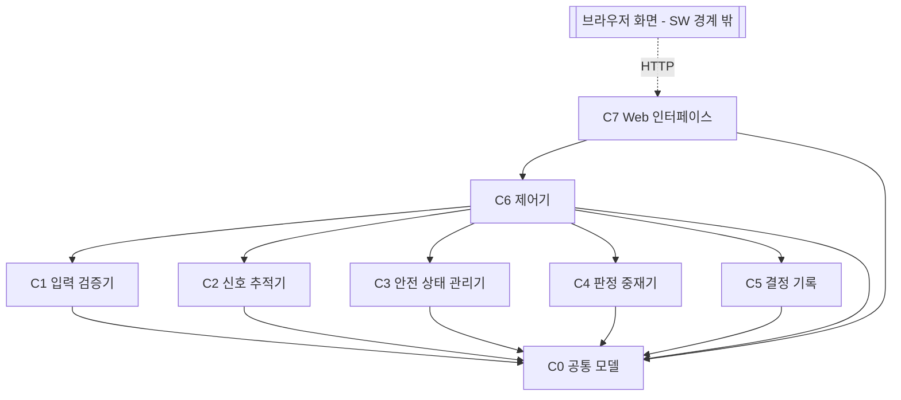
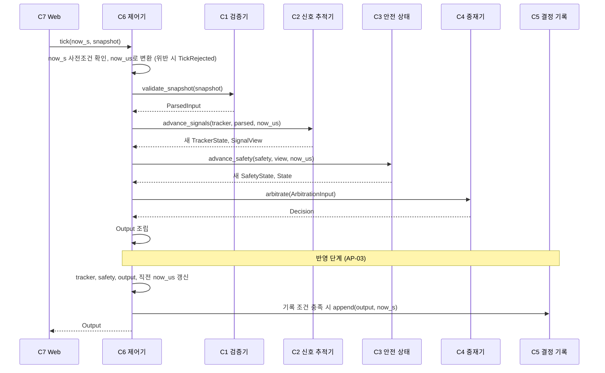
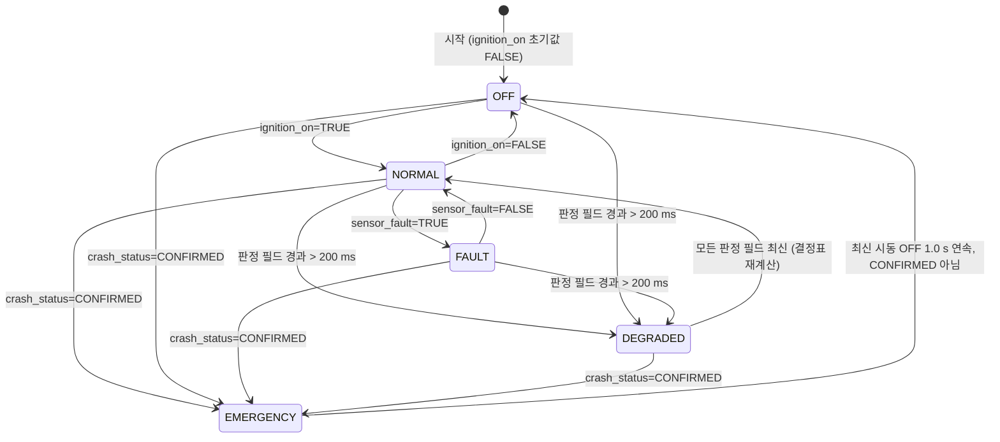

# SW 아키텍처 설계서: 전자식 차일드락 제어 SW

| 항목 | 내용 |
|---|---|
| 문서 ID | SWA-ECL-001 |
| 버전 | 1.0 (기준선 BL-SWA-1.0 후보) |
| 입력 | SWRS-ECL-001 v1.1 (BL-SWR-1.1 후보), QA-ECL-001 |
| 하위 문서 | SWD-ECL-001 상세 설계서, SAP-ECL-001 정적 분석 계획 |
| 검토 | DRV-ECL-001 설계 검토 기록 |
| 프로세스 | A-SPICE SWE.2 |

## 1. 설계 원칙

| ID | 원칙 | 근거 |
|---|---|---|
| AP-01 | 판정 로직(입력 검증, 신호 추적, 상태, 중재)은 외부 입출력이 없는 Python 모듈로 만들고, HTTP는 가장 바깥 구성요소에만 둔다 | 단위 시험 용이성, 브랜치 커버리지 100% |
| AP-02 | 시각은 매 틱 `now_s` 인자로만 받고, 내부에서는 **정수 마이크로초**(`now_us`)로 바꿔 모든 시각 비교를 정수로 한다. `time`, `random`, 스레드를 쓰지 않는다 | SWR-016 결정론, 부동소수점 경계 오차 방지 (DR-01) |
| AP-03 | 한 틱의 계산은 새 상태를 먼저 모두 만들고, 마지막 반영 단계에서 상태 갱신과 기록 추가를 한 번에 한다. 반영 단계 전에 예외가 나면 이전 상태가 그대로 남는다 | 상태 일관성, FFI |
| AP-04 | 구성요소 사이에는 불변 데이터만 주고받는다. frozen dataclass의 dict 필드는 `MappingProxyType`으로 감싼다 | 의도치 않은 상태 공유 방지 |
| AP-05 | 런타임 의존성은 표준 라이브러리만 쓴다 | D-04, SBOM 최소화 |
| AP-06 | SW 경계 안의 모든 구성요소(C0~C7의 Python 코드)를 ASIL B 수준으로 개발한다 | D-03, ISO 26262-9 공존 기준 |

## 2. 정적 구조

### 2.1 구성요소

| ID | 구성요소 | 모듈 | 책임 |
|---|---|---|---|
| C0 | 공통 모델 | `childlock/model.py` | 열거형, 상수, 그리고 **구성요소 사이에 오가는 모든 불변 타입** |
| C1 | 입력 검증기 | `childlock/validation.py` | 원시 입력을 필드별로 검사해 `ParsedInput`을 만든다 |
| C2 | 신호 추적기 | `childlock/signals.py` | 필드별 직전 유효값, 갱신 시각, 스냅샷 순서를 관리하고 `SignalView`를 만든다 |
| C3 | 안전 상태 관리기 | `childlock/safety_state.py` | EMERGENCY 래치, 상태 결정표, 도어별 override 기억 정리 |
| C4 | 판정 중재기 | `childlock/arbitration.py` | 우선순위표에 따라 도어별 출력·reason·순위·새 override 기억을 정한다 (순수 함수) |
| C5 | 결정 기록 | `childlock/event_log.py` | 결정 기록 생성, event_id, 최근 100건 보존 |
| C6 | 제어기 | `childlock/controller.py` | now_s 사전조건, 틱 조율(C1~C5), 출력 조립, 기록 조건, 상태 조회 |
| C7 | Web 인터페이스 | `childlock/web.py`, `childlock/__main__.py` | HTTP ↔ C6 변환, 오류 코드 결정, 시뮬레이터 화면 파일 제공 |
| (경계 밖) | 시뮬레이터 화면 | `childlock/static/index.html` (브라우저에서 실행되는 JS) | 시험자의 입력 편의. SW 경계 밖의 비안전 요소 (4.1절) |

### 2.2 의존 관계

- C1~C5는 C0에만 의존하고, 서로 import하지 않는다. 그래서 구성요소 사이에 오가는 타입은 모두 C0에 둔다.
- C6은 C0~C5를, C7은 C6과 C0만 import한다.
- 각 구성요소의 내부 상태 타입(`TrackerState`, `SafetyState`)은 해당 구성요소에 두고, C6만 보관한다.

### 2.3 구성요소 간 인터페이스

| 타입 (C0) | 생산자 | 소비자 | 내용 |
|---|---|---|---|
| `ParsedInput` | C1 | C2 | 유효 필드, 오류 필드 목록, 명령, 명령 오류 여부, timestamp |
| `SignalView` | C2 | C3, C4(C6 경유), C6 | 유효값, 갱신 지연, 최신 필드 집합, 순서 유효, 프레임 CONFIRMED, 입력 오류 여부, 명령 |
| `DoorMemory` | C3, C4 | C3, C4 | 도어별 억제 시각(µs)과 override |
| `ArbitrationInput` | C6 | C4 | 중재에 필요한 값 묶음 |
| `DoorDecision`, `Decision` | C4 | C6 | 도어별 출력, reason, 순위, 새 기억 |
| `Output` | C6 | C5, C7 | SWRS 3.3절 출력 |
| `DecisionRecord` | C5 | C6, C7 | SWR-011 기록 |

### 2.4 외부 인터페이스

| 인터페이스 | 제공 | 형태 | 관련 OEM IF |
|---|---|---|---|
| 틱 진행 | C6 `ChildLockController.tick(now_s, snapshot)` | Python 호출. 사전조건 위반이면 `TickRejected` 예외 | IF-001~004, 007~009 |
| 출력 | C6 `tick` 반환값, `status()` | `Output` | IF-005, 006 |
| 기록 조회 | C6 `events()` | `tuple[DecisionRecord, ...]` | IF-006 |
| HTTP | C7 | `POST /api/tick`, `GET /api/status`, `GET /api/events`, `GET /` | IF-004, 006 |

## 3. 동적 동작

### 3.1 한 틱의 처리 순서

### 3.2 상태 기계

state는 매 틱 상태 결정표(SWRS 4장)로 다시 계산한다. 아래 그림은 그 결과로 생기는 전이다.

복귀 대상은 대표값으로 그렸다. 실제로는 결정표를 다시 계산한 결과다(예: DEGRADED에서 복귀할 때 시동이 꺼져 있으면 OFF).

## 4. 안전 설계

### 4.1 ASIL 할당, 공존, SW 경계

- **SW 경계:** C0~C7의 Python 코드가 SW 경계 안이다. 브라우저에서 실행되는 시뮬레이터 화면(JS)은 **별도 프로세스(브라우저)에서 동작하는 경계 밖의 비안전 요소**다.
  - 화면이 SW에 영향을 주는 통로는 HTTP 요청 하나뿐이다.
  - 그 요청은 C7과 C1이 신뢰하지 않는 입력으로 다루고 모두 검증한다. 그래서 화면에 결함이 있어도 잘못된 입력 이상의 영향을 줄 수 없고, 잘못된 입력은 SWR-013이 처리한다.
  - 화면은 Table 1 적용, 커버리지 측정 대상이 아니다.
  - 5단계 Web 검증의 합격 판정은 화면 표시가 아니라 `GET /api/status`, `GET /api/events` 응답으로 한다. 그래서 화면 결함이 검증 결과를 거짓 통과나 거짓 실패로 만들 수 없다(검증 도구로서의 영향 배제).
- **공존:** C4가 ASIL B 규칙과 QM 규칙을 함께 처리하고 모두 한 프로세스에서 동작하므로, 구성요소를 분리해 간섭이 없음(FFI)을 보이는 방법은 쓰지 않는다. 대신 경계 안의 모든 구성요소를 ASIL B 수준으로 개발한다(AP-06).
- **ASIL B 우선:** ASIL B 동작이 QM 동작보다 우선한다는 것은 C4의 고정 우선순위로 구현하고, SWR-019의 55쌍과 세 규칙 조합 시험으로 검증한다.

### 4.2 간섭 요인과 대응

| 간섭 요인 | 대응 |
|---|---|
| C7(HTTP 처리)의 예외 | `TickRejected`(사전조건 위반)는 400으로, 그 밖의 모든 예외는 500으로 바꾼다. 응답 없이 연결이 끊기는 경로가 없다. C6 상태는 AP-03으로 보호된다 |
| 메모리 공유 | 구성요소 간 데이터는 불변이다(AP-04) |
| 실행 순서·타이밍 | 단일 스레드 `http.server.HTTPServer`를 쓴다. 틱은 한 번에 하나씩 처리된다 |
| 자원 고갈 | 결정 기록은 100건으로 제한하고, HTTP 요청 본문은 64 KiB로 제한한다(DD-03) |

### 4.3 고장 대응 메커니즘

| 메커니즘 | 위치 | 대상 고장 | 관련 SWR |
|---|---|---|---|
| 필드 형식·범위 검사 (큰 정수, NaN 포함) | C1 | 잘못된 값, 누락 | 013 |
| 필드별 갱신 감시 (200 ms, 정수 µs 비교) | C2 | 신호 끊김, 고착, 지속 오류, 역순 프레임 | 013 |
| 센서 고장 시 출력 유지 | C4 4순위 | sensor_fault 보고 | 021 |
| 충돌 래치와 해제 조건 | C3 | 충돌 후 오동작, 시동 신호 일시 변동 | 007 |
| now_s 사전조건 검사 | C6 | 잘못된 시각 주입 | 015, 016 |

### 4.4 사전 존재 SW와 도구

| 항목 | 사용 범위 | 논거 (교육용 범위) |
|---|---|---|
| CPython 3.12.10 | 실행 환경 | 버전 고정. 사용 기능을 SAP-ECL-001 3절 언어 부분집합으로 제한. 동작은 단위·통합·SIL 시험으로 확인 |
| 표준 라이브러리 `dataclasses`, `enum`, `math`, `types`, `typing`, `collections`, `collections.abc`, `json`, `http.server`, `importlib.resources`, `argparse`, `sys` | C0~C7 (`argparse`, `sys`는 C7 `__main__`만) | 여기 없는 모듈을 새로 쓰려면 이 표를 개정해야 하며, PR 리뷰에서 확인한다. 결정론과 동시성에 영향을 주는 모듈은 Ruff banned-api로 자동 금지한다(SAP PS-02) |
| Ruff, mypy, pytest, pytest-cov, check_metrics | 검증 도구 | 도구 신뢰 수준은 SAP-ECL-001 7절 참조 |

ISO 26262-8 12절(SW 구성요소 적격성)과 11절(도구 적격성)의 정식 평가는 교육 프로젝트 범위 밖이다. 위 표는 그 대신 사용 제한과 확인 방법을 기록한 것이다.

## 5. 자원과 타이밍

| 항목 | 예산 | 근거 |
|---|---|---|
| 틱 처리 시간 | PC/SIL에서 10 ms 틱 안 (목표 1 ms 미만) | Q-08. 틱당 처리량 일정 (O(1)) |
| 메모리 | 결정 기록 100건 + 고정 크기 상태 | SWR-012 |
| 지연 | 반영 주기에 출력 결정 (0 ms) | SWR-007 300 ms, SWR-013 100 ms 예산 충족 |

실시간성 보장은 PC/SIL 범위 밖이다. 시간 요구는 주입식 시계로 논리적으로 검증한다.

## 6. 추적성

### 6.1 SWR → 구성요소

| SWR | 구성요소 | SWR | 구성요소 |
|---|---|---|---|
| 001 | C4 | 012 | C5 |
| 002 | C4 | 013 | C1, C2, C3 (DEGRADED), C4 (2순위), C6 (input_validity) |
| 003 | C4 | 014 | C6 |
| 004 | C4 | 015 | C7, C6 (now_s 사전조건) |
| 005 | C4, C3 | 016 | C6 (전체), AP-02 |
| 006 | C3, C4 | 017 | C4 |
| 007 | C2, C3, C4 | 018 | C4 |
| 008 | C4 | 019 | C4, C6 (priority_reason) |
| 009 | C4, C3 | 020 | C3 (상태, override 정리), C4 (6순위), C6 (초기 출력) |
| 010 | C5, C6 (기록 조건) | 021 | C3, C4, C6 (warning_code) |
| 011 | C5 | | |

### 6.2 구성요소 → SWR

| 구성요소 | SWR |
|---|---|
| C0 | 데이터 정의 (SWRS 3장) |
| C1 | 013 |
| C2 | 007, 013 |
| C3 | 005, 006, 007, 009, 013, 020, 021 |
| C4 | 001~009, 013, 017~021 |
| C5 | 010, 011, 012 |
| C6 | 010, 013, 014, 015, 016, 019, 020, 021 |
| C7 | 015 |

SWR 21건이 모두 하나 이상의 구성요소에 할당됐다. 모든 구성요소에는 SWR이 할당돼 있다. 함수 단위 추적은 SWD-ECL-001 11장에 있다.

## 7. 설계 결정

| ID | 결정 | 대안 | 선택 이유 |
|---|---|---|---|
| AD-01 | 중재기를 순수 함수로 설계 | 상태를 가진 클래스 | 우선순위 시험을 입력과 기대값만으로 만들 수 있다 |
| AD-02 | state를 매 틱 결정표로 다시 계산 | 이벤트 기반 전이 | SWRS 4장 결정표와 1:1 대응하고, 놓치는 전이가 없다 |
| AD-03 | 단일 스레드 HTTPServer | ThreadingHTTPServer | 틱 직렬 처리와 결정론 보장 |
| AD-04 | 시뮬레이터 화면을 정적 HTML 1개 + 내장 JS로 작성하고 SW 경계 밖에 둔다 | 프런트엔드 프레임워크, 경계 안 포함 | 런타임 의존성 0개, 안전 경계 단순화 |
| AD-05 | 내부 시각을 정수 µs로 처리 | float 초 그대로 | 경계 비교(0.200 s, 1.0 s, 10.0 s)를 오차 없이 판정 (DR-01) |
